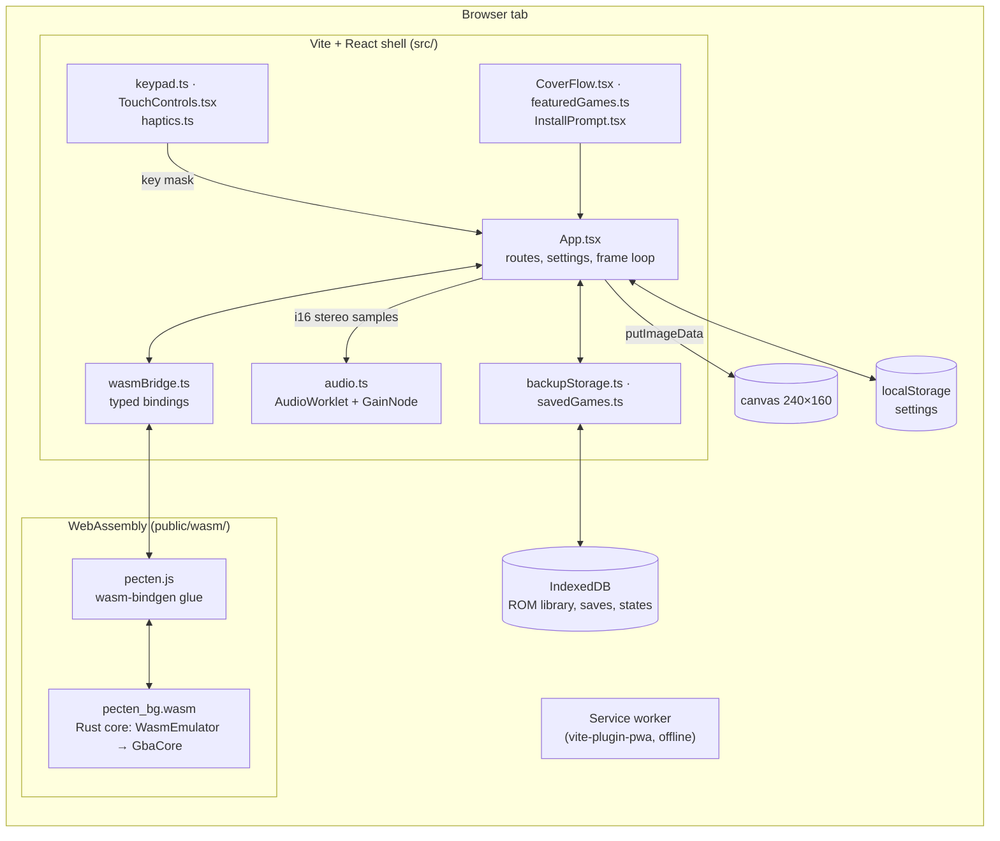
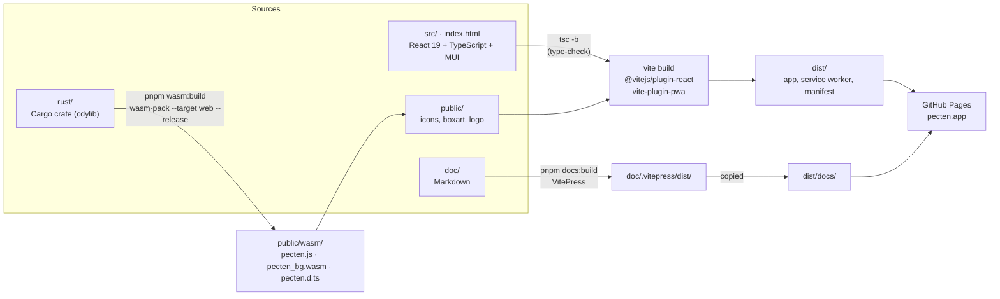
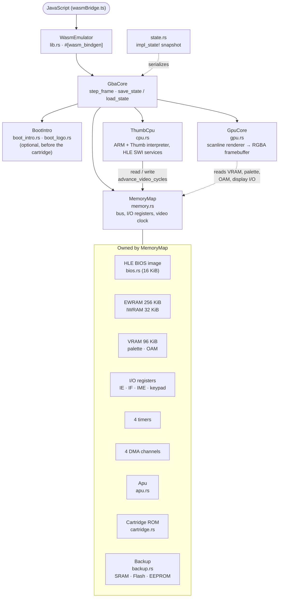
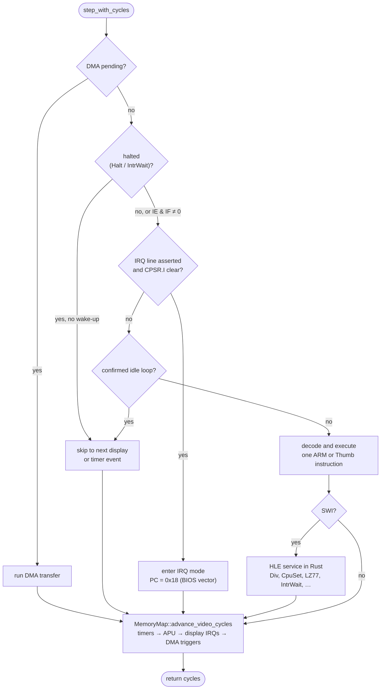
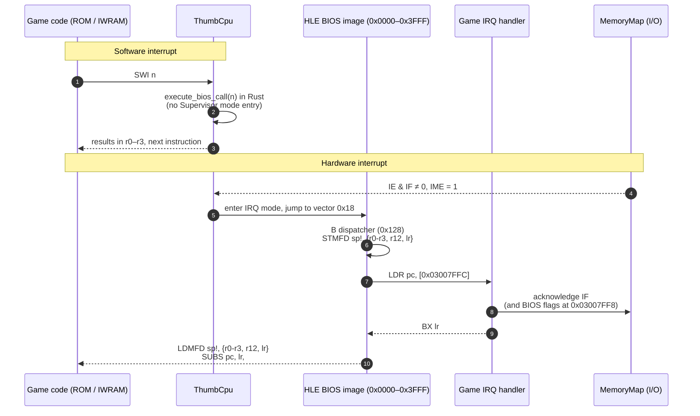

# Architecture Overview

The project is split into a few clear concerns:

- `rust/`: emulator core logic, memory model, GPU, APU, saves, and test suite
- `src/`: browser application code and wasm bridge
- `public/`: generated wasm assets (`public/wasm/`), featured cover art, and app icons
- `doc/`: public project documentation built with VitePress
- `scripts/`: maintenance scripts, such as fetching cover art

## System at a glance

Pecten is a single-page React app that runs the emulator as a WebAssembly module in the same browser tab. The React shell owns everything the player sees and touches; the Rust core owns the machine. They meet only at the `WasmEmulator` API ([WASM Boundary](./wasm-boundary.md)).

## Build pipeline

Two toolchains produce one static site. `wasm-pack` compiles the Rust crate to WebAssembly and writes the module and its JavaScript glue into `public/wasm/`. Vite then builds the React app; it copies `public/` as-is, and `wasmBridge.ts` imports `wasm/pecten.js` at runtime (`/* @vite-ignore */`), so the wasm module is never bundled. VitePress builds this documentation separately, and the deploy workflow places it under `/docs/`. The commands are listed in [Development Workflow](../guide/workflow.md).

`pnpm build` runs the first three steps in order (`wasm:build`, `tsc -b`, `vite build`); `pnpm dev` runs `wasm:build` and then the Vite dev server, so a core change needs `pnpm wasm:build` (or a restart) to reach the page. On every push to `main`, `.github/workflows/deploy-docs.yml` installs Rust with the `wasm32-unknown-unknown` target and `wasm-pack`, runs `pnpm build` and `pnpm docs:build`, and publishes `dist/`.

## Inside the core

`GbaCore` owns three parts: the CPU, the memory map, and the renderer. `MemoryMap` owns every memory region and every device that is clocked with memory, so the CPU advances all of them through one call, `advance_video_cycles`. The browser never reaches past `WasmEmulator`.

## CPU, HLE BIOS, and interrupts

Each call to `ThumbCpu::step_with_cycles` does exactly one unit of work and returns the cycles it took, which `MemoryMap` then spends on timers, the APU, display timing, and DMA triggers. `GbaCore::step_frame` repeats it until the display enters VBlank, rendering each scanline as soon as its HBlank begins ([GPU Pipeline](./gpu-pipeline.md)).

No real BIOS runs. The generated image only holds the exception vectors and the hardware IRQ dispatcher, so a game's interrupt handler is entered exactly as on hardware, while `SWI` calls are answered by Rust code in a single step ([HLE BIOS](../rust-core/bios.md)):

## Separation of responsibilities

### Emulator core

The Rust crate owns simulation correctness: reading and writing memory, processing rendering state, and modeling game-system behavior. It has no dependency on the browser.

| Module | Responsibility | Docs |
| --- | --- | --- |
| `lib.rs` | `GbaCore` (frame stepping, save states) and the `wasm_bindgen` exports | [WASM Boundary](./wasm-boundary.md) |
| `cpu.rs` | ARM7TDMI interpreter and HLE BIOS services | [ARM7TDMI CPU](../rust-core/thumb-cpu.md), [HLE BIOS](../rust-core/bios.md) |
| `bios.rs` | Generated BIOS image: vectors and IRQ dispatcher | [HLE BIOS](../rust-core/bios.md) |
| `memory.rs` | Bus, I/O registers, timers, DMA, and the video clock | [Memory Map](../rust-core/memory-map.md) |
| `cartridge.rs` | Cartridge header validation | [Memory Map](../rust-core/memory-map.md) |
| `backup.rs` | SRAM, Flash, and EEPROM save memory | [Memory Map](../rust-core/memory-map.md#cartridge-backup) |
| `gpu.rs` | Scanline renderer | [GPU Core](../rust-core/gpu-core.md) |
| `apu.rs` | Sound channels and mixing | [Audio](../rust-core/apu.md) |
| `state.rs` | Save-state serialization | [WASM Boundary](./wasm-boundary.md#save-states) |

### Browser layer

The app shell owns user experience: controls, canvas presentation, input handling, and the browser-specific environment.

| Module | Responsibility |
| --- | --- |
| `App.tsx` | Routes (home, play, library), the frame loop, settings, and the Saves and Settings dialogs |
| `wasmBridge.ts` | Loads and types the generated bindings |
| `keypad.ts`, `TouchControls.tsx`, `haptics.ts` | Keyboard and touch input, haptic ticks |
| `audio.ts` | AudioWorklet output at the game speed |
| `backupStorage.ts`, `savedGames.ts` | IndexedDB storage for saves and states, and for the ROM library |
| `CoverFlow.tsx`, `coverFlowMotion.ts`, `featuredGames.ts` | Home page cover flow |
| `touchThemes.ts` | Touch-control colour themes (palettes in `App.css`) |
| `InstallPrompt.tsx` | PWA install prompt |

### WASM boundary

The boundary between the browser and the Rust core is intentionally narrow. The app loads the wasm module and calls small exported functions that return plain data structures like bytes or basic values. See [WASM Boundary](./wasm-boundary.md).
