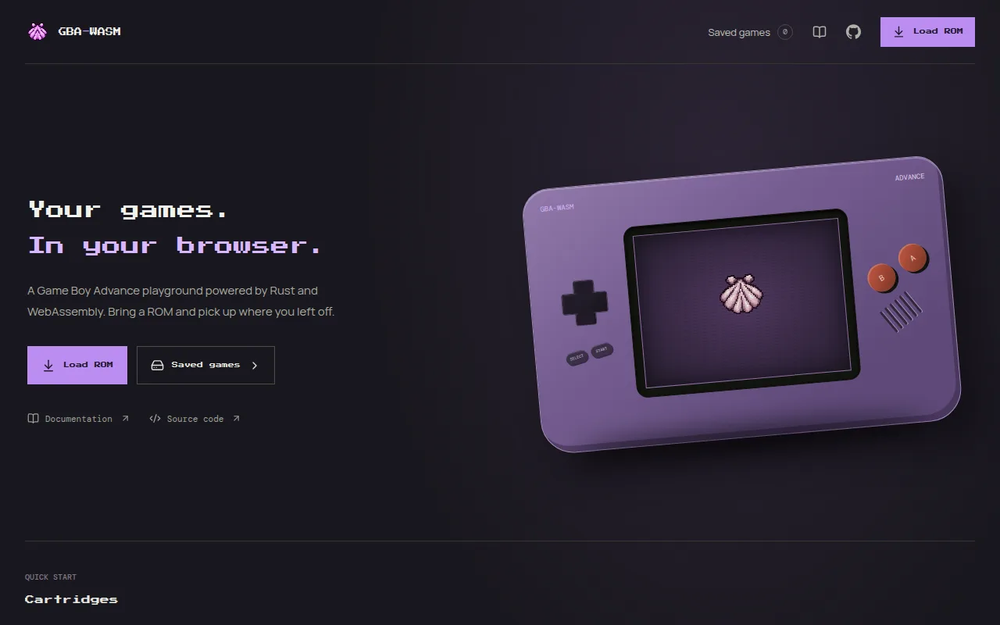
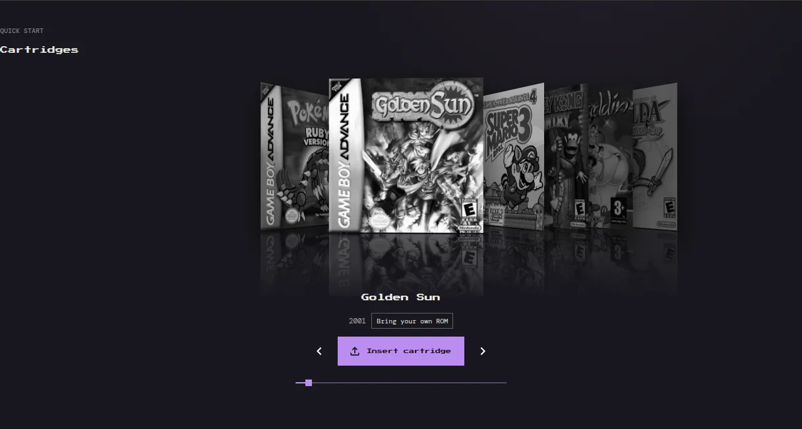
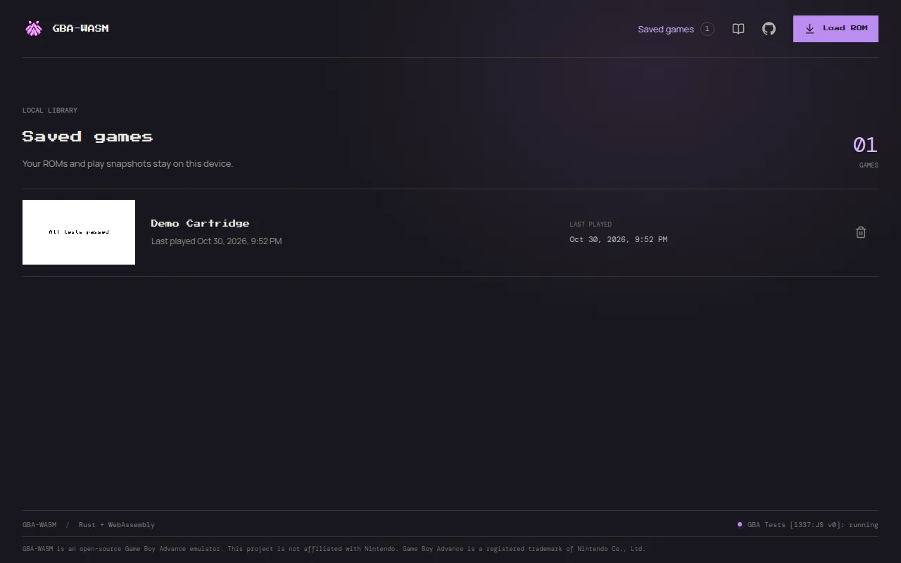

# Getting Started

GBA-WASM runs Game Boy Advance games in your browser. Everything stays on your device: ROMs, saves, and settings are stored by the browser and never uploaded.

## Load a game

1. Click **Load ROM** in the header or on the home page.
2. Pick a `.gba` (or `.bin`) file. GBA-WASM does not include any games; you bring your own ROM.
3. The game opens on the play screen and is added to your library.

If a file cannot be loaded, the play screen shows a diagnostic log with the file name, size, the stage that failed, and the error. Copy it into a bug report if you think the ROM should work.

::: tip
If a game stays black, the play screen shows **No video output yet** after about two seconds. The emulator is still incomplete, so some games do not boot.
:::

## The home page

The **Cartridges** cover flow lists every game you have played, most recent first, followed by a few well-known titles. Covers of games you have never loaded here are grey and their button reads **Insert cartridge**: it opens the file picker, because ROMs are never bundled. Covers of games in your library launch them directly.

Scroll the covers by dragging, swiping, using the horizontal scroll wheel or trackpad, the arrow buttons, or the slider. With the cover flow focused, <kbd>←</kbd>/<kbd>→</kbd> move between covers and <kbd>Enter</kbd> launches the centred one. The covers advance on their own until you hover over or touch them.

**Recently played** shows your last three games.

## Your library

**Saved games** in the header opens the library: every ROM you have loaded, with a screenshot and the last time you played it. Click a game's picture to play it, or the bin icon to remove it.

The picture of a game is updated each time the game saves or you save a state, so it shows where you left off.

::: warning
Removing a game from the library deletes the ROM copy, not its saves. If you load the same ROM again, its save and save states come back, because they are tied to the ROM contents (see [Saved Games](./saves.md)).
:::

## Install as an app

On browsers that support it, GBA-WASM offers to install itself as an app (a PWA). Installed, it opens fullscreen from your home screen and works offline.

- **Android and desktop Chrome or Edge:** click **Install** in the prompt, or use the browser's install menu.
- **iPhone and iPad:** in Safari, tap **Share**, then **Add to Home Screen**.

If you dismiss the prompt, it is not offered again for 14 days. It never appears on the play screen.

## Where your data lives

| Data | Stored in | Shared between |
| --- | --- | --- |
| ROM library | IndexedDB `gba-wasm-library` | nothing; one browser on one device |
| Game saves and save states | IndexedDB `gba-wasm-saves` | every library entry of the same ROM |
| Settings | `localStorage` | every game |

Clearing the site data in your browser deletes all of it. Use **Download .sav** to keep a copy of important saves ([Saved Games](./saves.md#export-a-save)).

## Next steps

- [Saved Games](./saves.md): automatic saves, save states, and moving saves between emulators
- [Settings](./settings.md): game speed, sound, touch controls, haptics, and themes
- [Desktop and Mobile Play](./play-modes.md): keyboard play and the portrait and landscape touch layouts
- [Controls and Shortcuts](./controls.md): every key binding
