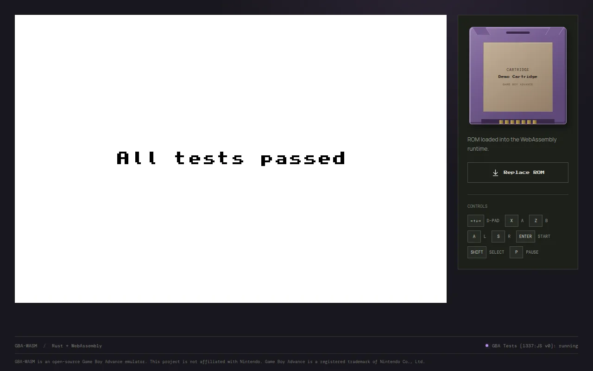
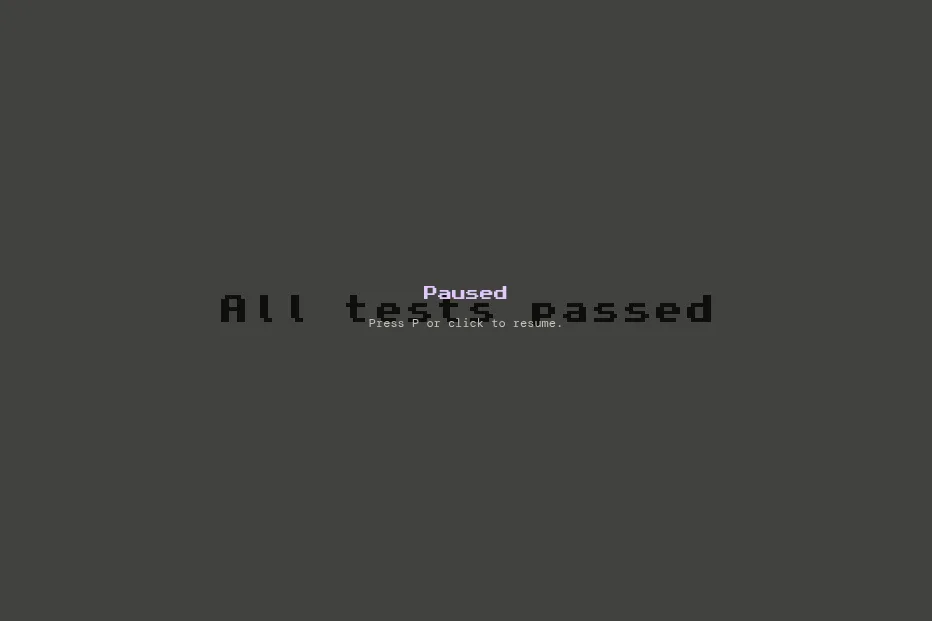
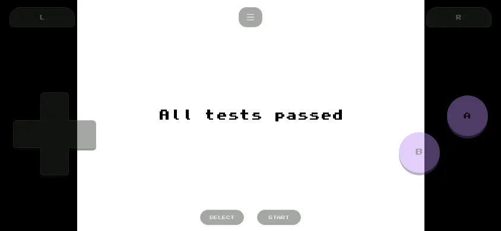
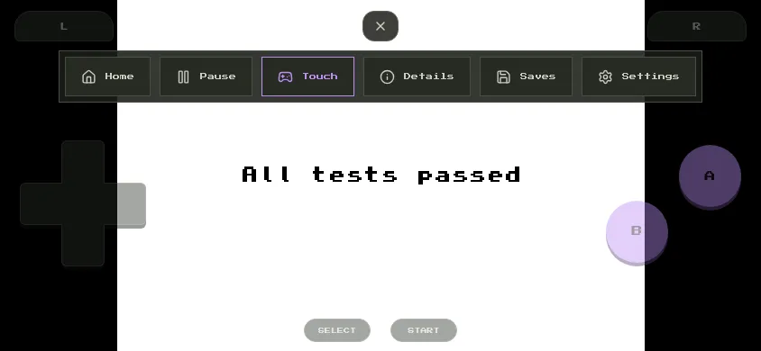

# Desktop and Mobile Play

The play screen adapts to the device: a computer gets a keyboard layout with a side panel, and a phone gets on-screen buttons in portrait or landscape. The layout follows the screen and the input device; there is nothing to choose apart from the [Touch controls](./settings.md#touch-controls) setting.

## Desktop with a keyboard

- The game is shown large, with the actions above it: **Home**, **Pause**, **Touch**, **Saves**, and **Settings**.
- The side panel shows the cartridge, a **Replace ROM** button, and a reminder of the keyboard controls.
- Play with the keyboard; see [Controls and Shortcuts](./controls.md).
- Touch controls are off by default. Turn them on with **Touch** if you have a touchscreen laptop; they appear below the game.

Keys work anywhere on the page, except while a text field has focus. When the window loses focus, every held key is released, so no button stays stuck.

### Pausing

**Pause** or <kbd>P</kbd> freezes the game, including the sound. Click the game or press <kbd>P</kbd> again to resume.

## Mobile, portrait

Hold the phone upright for the layout closest to a real Game Boy Advance:

- The header and footer are hidden, so the game spans the full width.
- The actions become a row of icons above the game: Home, Pause, Touch, **Details**, Saves, and Settings. **Details** opens the cartridge panel that the desktop shows on the side.
- The buttons fill the space below the game: L and R on top, the D-pad and A/B in the middle, Select and Start at the bottom.

## Mobile, landscape

Turn the phone sideways for the biggest picture:

- The game fills the screen height, on a black background.
- The buttons float over the sides, semi-transparent: L and R in the top corners, the D-pad on the left, A and B on the right, Select and Start along the bottom edge.
- The page cannot scroll, so swipes never move the screen.
- The actions are hidden. Tap the small **menu** button at the top centre to show them, and tap it again (or any action) to hide them.

This layout applies to touch screens up to 540 pixels high, which covers phones. Tablets in landscape use the desktop layout with the touch controls below the game.

## Using the touch controls

- **Several fingers at once:** every finger is tracked separately, so you can hold B to run while steering and pressing A.
- **Slide between buttons:** a finger can slide from one button to another without lifting, for example from B to A.
- **D-pad as a joystick:** once a finger touches the D-pad, the direction follows its angle from the centre, even if it slides past the edge. Diagonals are as easy to hit as straight directions, and a small dead zone in the centre presses nothing. The cross tilts toward the direction you press.
- Pressed buttons light up, and the [haptic feedback](./settings.md#haptic-feedback) setting adds a vibration.
- All buttons are released when you switch apps or the screen turns off.

## Tips for phones

- [Install GBA-WASM](./index.md#install-as-an-app) as an app for true fullscreen without the browser's address bar.
- Lock the rotation if the layout switches while you play.
- On iPhone, haptics need iOS 18 or later.
