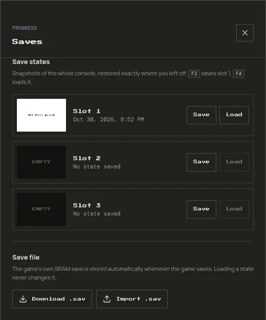
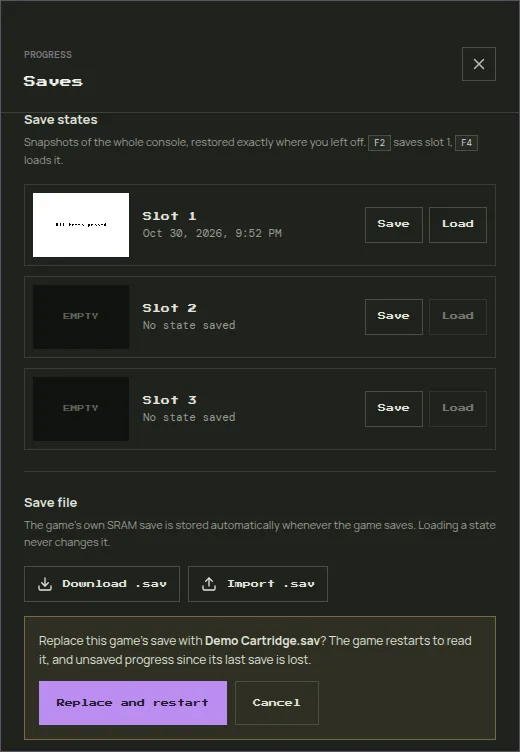

# Saved Games

GBA-WASM keeps two kinds of progress, and they are independent:

| | Game save | Save state |
| --- | --- | --- |
| What it is | The cartridge's own save memory (SRAM, Flash, or EEPROM), written when *the game* saves | A snapshot of the whole console at any moment |
| Created | Automatically, whenever the game saves | By you, from the Saves dialog or with <kbd>F2</kbd> |
| Slots | One per game | Three per game |
| Works in other emulators | Yes, as a `.sav` file | No, the format is specific to GBA-WASM |

Both are tied to the ROM contents (its SHA-256 hash), not to the file name. Every library entry of the same ROM shares one save, and a different dump or revision of a game has its own.

Open the **Saves** dialog from the button above the game.

## Game saves

When a game writes its save, GBA-WASM waits until the game has stopped writing for half a second, then stores it and shows **Game saved**. It also stores pending saves when you leave the page, switch apps, or load another ROM. The next time you start the game, its save is loaded before it boots.

The save type is detected from the ROM, and the Saves dialog names it. A game without save memory shows **This cartridge has no save memory**.

If a stored save is unreadable or belongs to a different save type, it is not loaded, and the status bar says so. The game then starts without a save.

## Save states

A save state restores the game exactly where you were, including the music, even in places where the game does not let you save.

- **Save** stores a state in a slot, with a screenshot and the date. Saving into a used slot replaces it.
- **Load** restores a slot. It also works while the game is paused.
- <kbd>F2</kbd> saves to slot 1 and <kbd>F4</kbd> loads slot 1, without opening the dialog.

Loading a state never changes the game save. If you load an old state and then save in-game, the in-game save is overwritten as usual.

::: warning
Save states can be rejected after an update of GBA-WASM that changes the snapshot format. Keep important progress in a game save too. A rejected state shows an error and leaves the running game untouched.
:::

## Export a save

**Download .sav** downloads the game save as a raw `.sav` file named after the game. Use it to:

- back up your progress before clearing browser data;
- move a save to another browser or device (import it there);
- continue in another emulator.

The file is the raw save memory, the format most emulators and flash-cart tools use (mGBA, VBA-M, NanoBoyAdvance, and others).

## Import a save from another emulator

1. Load the game in GBA-WASM.
2. Open **Saves** and click **Import .sav**.
3. Pick the `.sav` file. GBA-WASM checks its size, then asks for confirmation.
4. Click **Replace and restart**. The game restarts so it can read the new save.

::: danger
Importing replaces the game save. Progress since the game's last save is lost. Download the current save first if you might want it back.
:::

### Accepted sizes

The file must match the cartridge's save memory:

| Save type | File size |
| --- | --- |
| SRAM | 32,768 bytes (32 KiB) |
| Flash 512K | 65,536 bytes (64 KiB) |
| Flash 1M | 131,072 bytes (128 KiB) |
| EEPROM | 512 or 8,192 bytes |

### If the file is rejected

- **Wrong size:** some emulators add extra data to the file, such as a real-time-clock footer, or pad it to a larger size. Remove the extra bytes from the end so the file has the size above. Keep a copy of the original.
- **No save memory:** the ROM you loaded has no save chip that GBA-WASM recognizes, so nothing can be imported.
- **Save states from other emulators** (`.ss0`, `.sgm`, `.state`, and so on) cannot be imported. Only raw `.sav` files work.

## Move to another device

1. On the old device, load the game, open **Saves**, and click **Download .sav**.
2. On the new device, load the same ROM, open **Saves**, click **Import .sav**, and pick the file.

Save states stay on the device where they were made.
