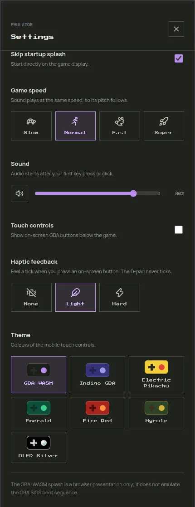
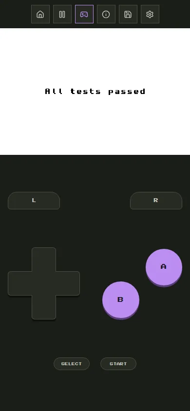
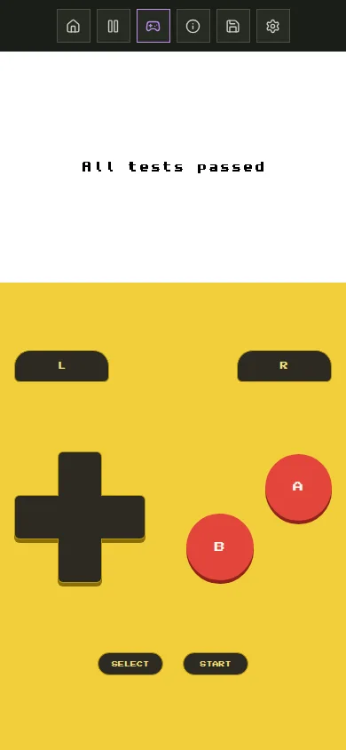
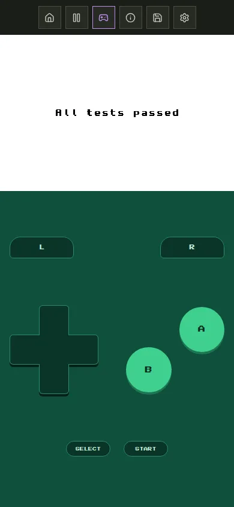
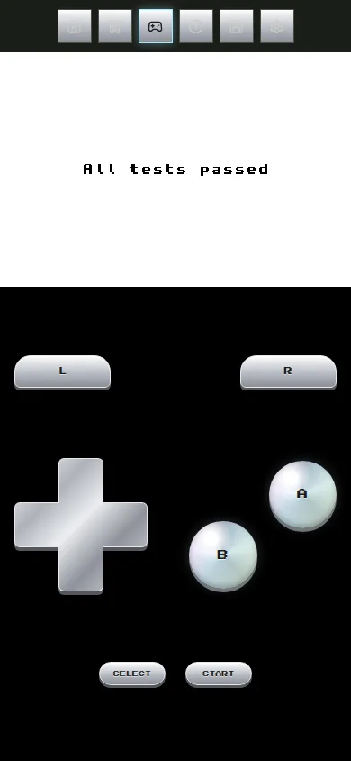

# Settings

Open **Settings** from the button above the game. Changes apply immediately and are remembered by the browser for every game.

## Skip startup splash

When off, a GBA-WASM logo shows for about two seconds when a game starts. Tap it to skip it. The splash is decoration only; it is not the Game Boy Advance boot animation.

## Game speed

| Option | Speed | Use it for |
| --- | --- | --- |
| Slow | ×0.5 | tricky sections |
| Normal | ×1 | normal play, 59.73 frames per second like the console |
| Fast | ×2 | skipping dialogue and grinding |
| Super | ×4 | long walks and grinding |

Sound plays at the same speed as the game, so its pitch rises at Fast and Super and drops at Slow. On slower devices, Super may not reach four times normal speed.

## Sound

The speaker button mutes and unmutes the game; the slider sets the volume. Browsers only allow sound after you interact with the page, so audio starts on your first key press, click, or tap.

## Touch controls

Shows the on-screen GBA buttons. It is on by default on phones and tablets and off on computers. The **Touch** button above the game toggles the same setting. See [Desktop and Mobile Play](./play-modes.md) for the layouts.

The on-screen buttons and the keyboard work together, so you can use both at once.

## Haptic feedback

A short vibration when you press an on-screen button:

| Option | Effect |
| --- | --- |
| None | no vibration |
| Light | short tick (30 ms) |
| Hard | longer tick (60 ms) |

The D-pad never vibrates, because its direction changes too often while you steer.

::: info Device support
- **Android (Chrome and other Chromium browsers):** uses the phone's vibration motor. Nothing happens while the ringer is on Silent, or when *Settings → Vibration & haptics → Touch feedback* is off.
- **iPhone (iOS 18 and later):** plays the system haptic. Light and Hard feel the same, and a tick plays when a finger lands on a button, not when it slides onto one.
- **Computers and browsers without vibration support:** the setting has no effect.
:::

## Theme

Colours of the touch controls and of the play screen while touch controls are shown. Seven themes are available: GBA-WASM, Indigo GBA, Electric Pikachu, Emerald, Fire Red, Hyrule, and OLED Silver.

  <figure><figcaption>GBA-WASM</figcaption></figure>
  <figure><figcaption>Electric Pikachu</figcaption></figure>
  <figure><figcaption>Emerald</figcaption></figure>
  <figure><figcaption>OLED Silver</figcaption></figure>

OLED Silver uses a pure black background, which saves battery on OLED screens.

